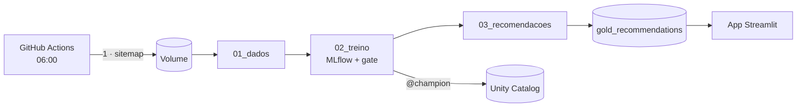

# Recomendação de notícias com MLOps no Databricks

**FIAP Pós-Tech · Fase 5 - MLOps · projeto de aula**

Um recomendador de notícias que **se re-treina sozinho todo dia** e só troca o modelo em
produção quando o novo é melhor.

- **Dados:** matérias **reais** do sitemap do O Globo + leitores e cliques **sintéticos**.
- **Modelos:** popularidade (baseline) Vs item-CF Vs **híbrido** (recomenda até matéria nova).
- **MLOps:** MLflow, Unity Catalog (`@champion`), quality gate, Job agendado, monitoramento.
- **Entrega:** app Streamlit + CI/CD no GitHub Actions + GitHub configurado com Terraform.



Detalhes e mais diagramas: [`docs/ARQUITETURA.md`](docs/ARQUITETURA.md).

## O que tem aqui

| Pasta / arquivo | Para quê |
|---|---|
| `notebooks/01_dados.ipynb` | sitemap → matérias (`bronze_articles`) + alerta de mudança nos dados (`data_monitoring`) + cliques sintéticos (`silver_*`) |
| `notebooks/02_treino.ipynb` | 3 modelos, MLflow, registro no Unity Catalog e quality gate |
| `notebooks/03_recomendacoes.ipynb` | top-10 de cada leitor (`gold_recommendations`) + monitoramento |
| `databricks.yml`, `resources/job.yml` | o Job (3 tasks) descrito em código (Asset Bundle) |
| `app/streamlit_app.py` | o app (lê a tabela gold; aba "Monte seu perfil" recomenda na hora para um leitor novo; sem conexão, usa `app/sample_data`) |
| `.github/workflows/` | `ci.yml` (lint + validação), `cd.yml` (deploy), `ingest.yml` (cron diário) |
| `infra/github/` | Terraform: repositório, secrets e proteção da `main` |
| `docs/` | arquitetura, guia do professor, roteiro da aula |

Todo o código do modelo está **dentro dos notebooks** - é o que se apresenta em aula.

## Instalação (macOS, Linux e Windows)

| Sistema | Antes de começar |
|---|---|
| macOS | `xcode-select --install` |
| Linux (Ubuntu/Debian) | `sudo apt install -y python3 python3-venv make curl unzip git jq` |
| Windows | PowerShell como administrador: `wsl --install -d Ubuntu-24.04`, depois use o terminal do Ubuntu |

```bash
make doctor        # confere o que está instalado
make db-install    # Databricks CLI (script oficial)
make install       # Python local para lint e app
```

## Rodando

```bash
make db-configure  # 1x: URL do workspace + token (Settings → Developer → Access tokens)
make setup         # cria schema e Volume e envia o sitemap de exemplo
make deploy        # publica notebooks + Job
make run           # roda o Job: dados → treino → recomendações
make app           # abre o app em http://localhost:8501
```

Sem parâmetro, tudo vai para o seu ambiente **dev** (isolado). Para os outros, `TARGET=qa` ou
`TARGET=prod`:

| Ambiente | Como é atualizado | Schema | App |
|---|---|---|---|
| dev | `make setup deploy run` (manual) | `news_recsys_dev` | `make app` (local) |
| qa | merge na `develop` → `cd.yml` | `news_recsys_qa` | Streamlit Cloud, branch `develop` |
| prod | merge na `main` → `cd.yml` + ingest diário | `news_recsys_prod` | Streamlit Cloud, branch `main` |

`make sitemap` envia o sitemap do dia. Os notebooks com os resultados ficam no Databricks:
**Jobs & Pipelines → execução → task**. `make db-destroy` apaga tudo do Databricks (Job,
tabelas, Volume, modelo e experimento) para recomeçar do zero com `make setup deploy run`.

## Publicando (GitHub + Streamlit Cloud)

Fluxo: `feature/*` → PR → `develop` (deploy em **QA**) → PR → `main` (deploy em **PROD**). Todo PR
roda o CI; `develop` e `main` só aceitam PR com CI verde.

**Tudo roda no GitHub Actions:**

| Quando | Workflow | Jobs |
|---|---|---|
| PR para `develop` ou `main` | `ci.yml` | `test` (lint + validação) → `infra-plan` (o que o Terraform vai mudar) |
| merge na `develop` / `main` | `cd.yml` | `infra` (Terraform) → `databricks` (QA / PROD) → `streamlit` (a app responde?) |
| todo dia 06:00 | `ingest.yml` | sitemap → Volume de PROD → Job |

O state do Terraform fica no Volume `workspace.default.tfstate` (o runner é descartável) e não
guarda tokens.

**Preparação manual, uma vez** (a esteira não pode criar as próprias credenciais):

```bash
make gh-login     # gh com permissão de workflow
make gh-repo      # cria o repositório público + remote origin
# GitHub → Settings → Developer settings → fine-grained PAT só deste repositório,
#   permissões Administration e Environments: read/write
make gh-secrets   # DATABRICKS_HOST/TOKEN (do ~/.databrickscfg) + o PAT (pede para colar)
make gh-push      # envia main e develop: a esteira assume
```

Para **recriar do zero** (ensaios): `make gh-destroy` (apaga o repositório e o state do Terraform)
→ `make gh-repo` → no PAT, *Edit* → *Repository access* → selecione o repositório novo →
`make gh-secrets` → `make gh-push`.

**Streamlit Cloud (2 apps, pela UI):** share.streamlit.io → *Create app* → este repositório,
`app/streamlit_app.py`:

- branch `develop`, URL `<seu-usuário>-news-recsys-qa`, secrets com `schema = "news_recsys_qa"`
- branch `main`, URL `<seu-usuário>-news-recsys-prod`, secrets com `schema = "news_recsys_prod"`

(secrets: modelo em `app/.streamlit/secrets.toml.example`). O Streamlit Cloud não tem API de
deploy: cada app se atualiza sozinha a cada push na sua branch; o job `streamlit` só confere.

## Custos

R$ 0: Databricks Free Edition, GitHub Actions (repo público) e Streamlit Community Cloud.

## Limitações conhecidas

- Os cliques são **sintéticos**: as métricas medem o padrão das personas, não leitores reais.
- O state do Terraform fica num Volume do Databricks e não guarda tokens (os secrets são criados pelo `make gh-secrets`).
- O token do Databricks expira: renove no GitHub (`make gh-secrets`) e no Streamlit Cloud.
