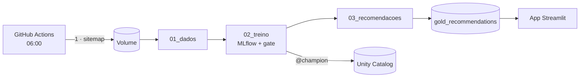

# Recomendação de notícias com MLOps no Databricks

**FIAP Pós-Tech · Fase 5 — MLOps · projeto de aula**

Um recomendador de notícias que **se re-treina sozinho todo dia** e só troca o modelo em
produção quando o novo é melhor.

- **Dados:** matérias **reais** do sitemap do O Globo + leitores e cliques **sintéticos**.
- **Modelos:** popularidade (baseline) × item-CF × **híbrido** (recomenda até matéria nova).
- **MLOps:** MLflow, Unity Catalog (`@champion`), quality gate, Job agendado, monitoramento.
- **Entrega:** app Streamlit + CI/CD no GitHub Actions + GitHub configurado com Terraform.



Detalhes e mais diagramas: [`docs/ARQUITETURA.md`](docs/ARQUITETURA.md).

## O que tem aqui

| Pasta / arquivo | Para quê |
|---|---|
| `notebooks/01_dados.ipynb` | sitemap → matérias (`bronze_articles`) + cliques sintéticos (`silver_*`) |
| `notebooks/02_treino.ipynb` | 3 modelos, MLflow, registro no Unity Catalog e quality gate |
| `notebooks/03_recomendacoes.ipynb` | top-10 de cada leitor (`gold_recommendations`) + monitoramento |
| `databricks.yml`, `resources/job.yml` | o Job (3 tasks) descrito em código (Asset Bundle) |
| `app/streamlit_app.py` | o app (lê a tabela gold; sem conexão, usa `app/sample_data`) |
| `.github/workflows/` | `ci.yml` (lint + validação), `cd.yml` (deploy), `ingest.yml` (cron diário) |
| `infra/github/` | Terraform: repositório, secrets e proteção da `main` |
| `docs/` | arquitetura, guia do professor, roteiro da aula |

Todo o código do modelo está **dentro dos notebooks** — é o que se apresenta em aula.

## Instalação (macOS, Linux e Windows)

| Sistema | Antes de começar |
|---|---|
| macOS | `xcode-select --install` |
| Linux (Ubuntu/Debian) | `sudo apt install -y python3 python3-venv make curl unzip git jq` |
| Windows | PowerShell como administrador: `wsl --install -d Ubuntu-24.04`, depois use o terminal do Ubuntu |

```bash
make doctor        # confere o que está instalado
make db-install    # Databricks CLI (script oficial)
make install       # Python local para lint e app
```

## Rodando

```bash
make db-configure  # 1x: URL do workspace + token (Settings → Developer → Access tokens)
make setup         # cria schema e Volume e envia o sitemap de exemplo
make deploy        # publica notebooks + Job
make run           # roda o Job: dados → treino → recomendações
make app           # abre o app em http://localhost:8501
```

`make sitemap` envia o sitemap do dia; `make export-notebooks` traz os notebooks executados
(com resultados) para a pasta `notebooks/`.

## Publicando (GitHub + Streamlit Cloud)

1. **GitHub com Terraform:** copie `infra/github/terraform.tfvars.example` para
   `terraform.tfvars`, faça `export TF_VAR_databricks_token=dapi...` e rode
   `make tf-init tf-plan tf-apply`. Depois `git push` para o repositório criado.
2. **Streamlit Cloud:** share.streamlit.io → *Create app* → este repositório, `main`,
   `app/streamlit_app.py` → *Advanced settings* → cole os secrets de
   `app/.streamlit/secrets.toml.example` (com `schema = "news_recsys"`).

## Custos

R$ 0: Databricks Free Edition, GitHub Actions (repo público) e Streamlit Community Cloud.

## Limitações conhecidas

- Os cliques são **sintéticos**: as métricas medem o padrão das personas, não leitores reais.
- O state do Terraform guarda o token do Databricks em texto puro (fica local, fora do git).
- O token do Databricks expira: renove no GitHub (`make tf-apply`) e no Streamlit Cloud.
