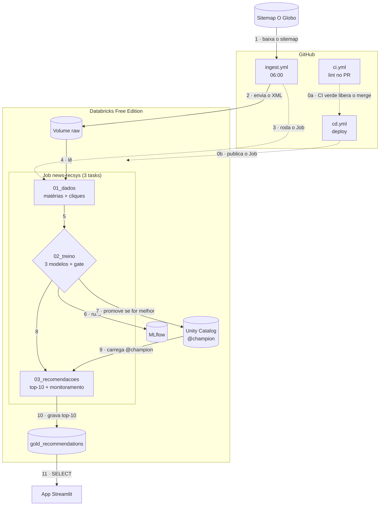
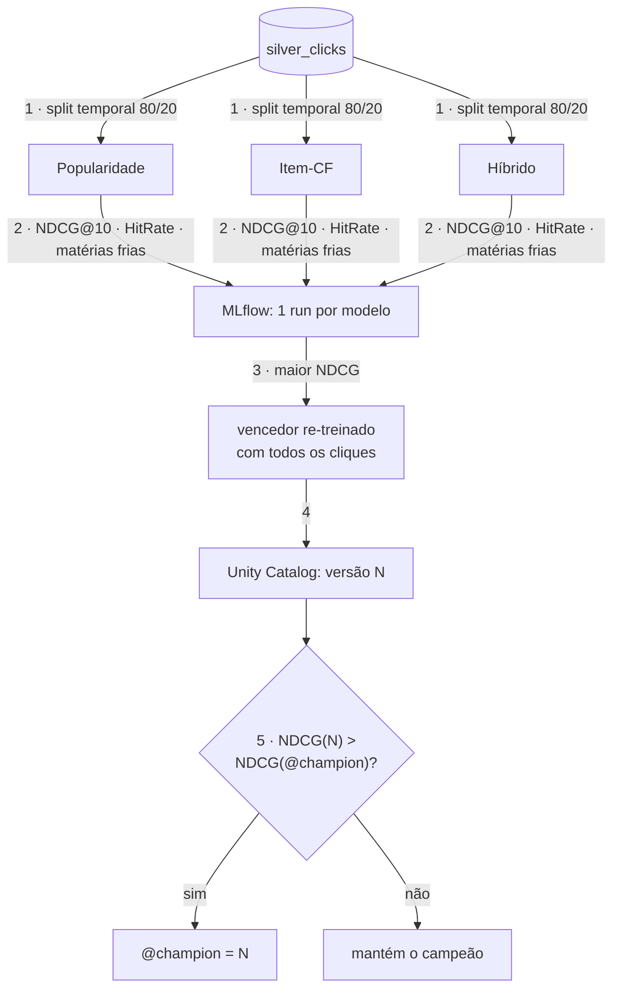
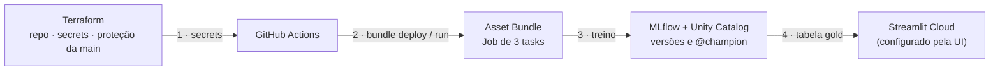

# Arquitetura

Siga os números das setas. O GitHub e o VS Code renderizam o Mermaid; para editar, use
<https://mermaid.live>.

## 1. Visão geral

| # | O que acontece |
|---|---|
| 0a · 0b | (só quando há merge na `main`) CI verde → `cd.yml` publica o Job |
| 1–3 | todo dia o GitHub baixa o sitemap, envia ao Volume e roda o Job |
| 4–5 | `01_dados` lê os XMLs, grava as matérias e simula os cliques |
| 6–7 | `02_treino` compara 3 modelos no MLflow; o vencedor só vira `@champion` se for melhor |
| 8–10 | `03_recomendacoes` usa o `@champion` e grava o top-10 de cada leitor |
| 11 | o app lê a tabela gold |

## 2. Treino e quality gate (`02_treino`)

Resultado com o sitemap de 12/10/2026: **híbrido NDCG@10 = 0,23** · item-CF 0,13 ·
popularidade 0,02. Só o híbrido acerta matérias novas (25–34%; os outros, 0%).

## 3. Quem gerencia o quê

## Decisões

1. **Código dentro dos notebooks:** é o que se mostra em aula. Além disso, neste workspace o
   Job falha ao importar `.py` de arquivos do workspace (erro de leitura do storage).
2. **Cliques sintéticos:** não existe clickstream público; só a etapa `01_dados` mudaria em produção.
3. **Inferência batch:** o top-10 fica pronto numa tabela; o app só faz `SELECT`.
4. **Alias `@champion`:** app e inferência nunca usam "a última versão"; rollback = mover o alias.
5. **Ingestão no GitHub Actions:** o Databricks Free Edition não acessa a internet.
6. **Terraform só para o GitHub:** na Free Edition o workspace já vem pronto; o Job é do Asset Bundle.
