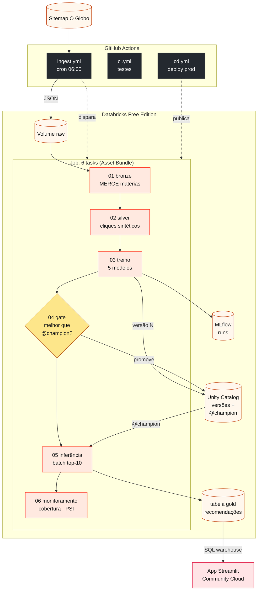
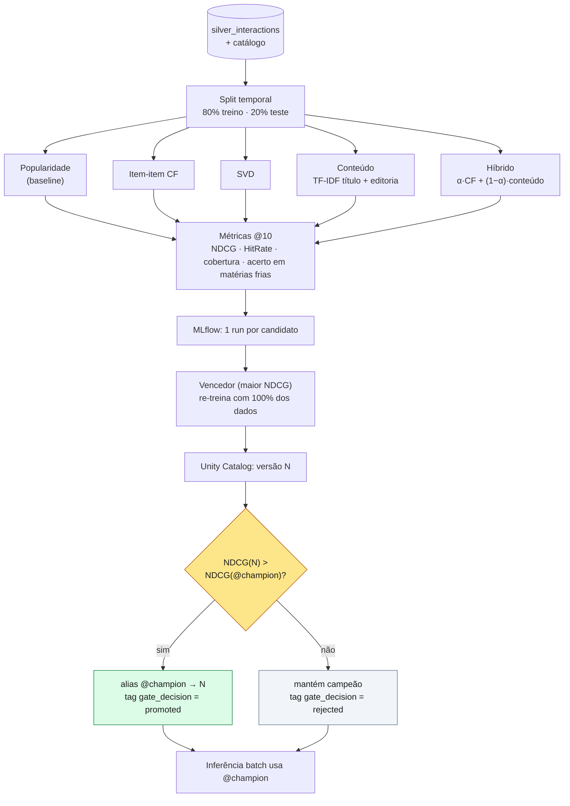
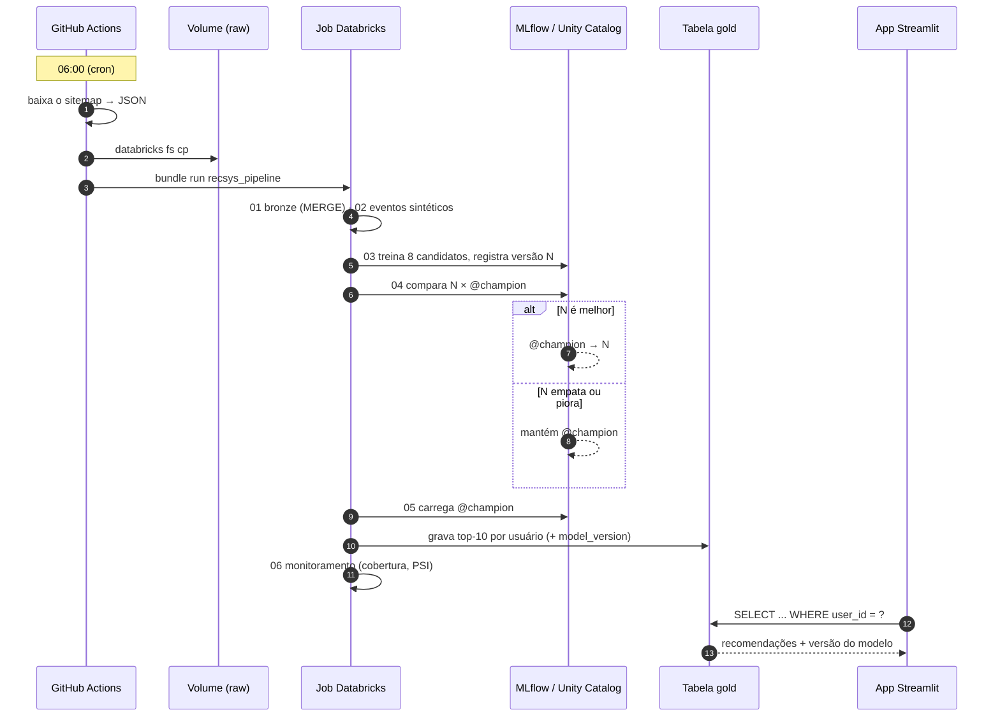
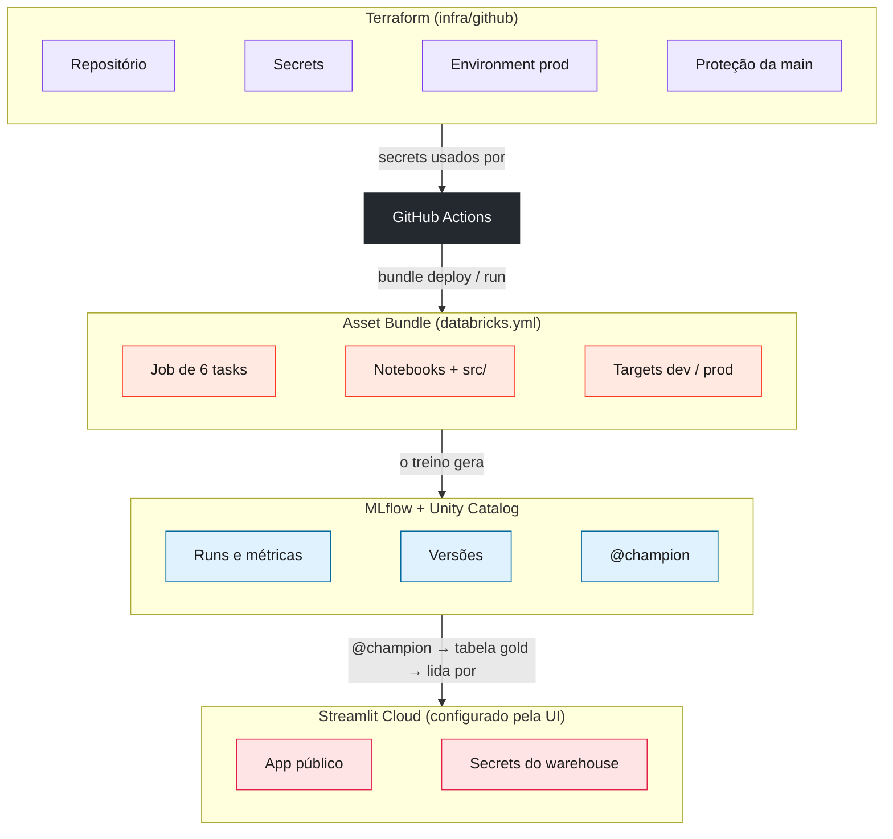

# Arquitetura em Mermaid

Diagramas para conduzir a aula explicando o fluxo. O GitHub e o VS Code (extensão
*Markdown Preview Mermaid Support*) renderizam direto; para editar visualmente, cole no
<https://mermaid.live> (Actions → *Export* → PNG/SVG) ou importe no draw.io
(*Arrange → Insert → Advanced → Mermaid*).

Ordem sugerida na aula: **1 → 2 → 3 → 4**.

---

## 1. Visão geral (o sistema inteiro)

**Como contar:** o GitHub busca o dado (a Free Edition não tem internet de saída) e dispara o Job; o Job
transforma e treina, o gate decide, a inferência batch grava a tabela gold e o app só faz um
`SELECT`.

---

## 2. Treino e promoção (o coração do MLOps)

**Números locais (07/10/2026):** híbrido α=0,4 venceu com NDCG@10 = 0,212 (popularidade:
0,035). CF e SVD acertam **0%** das matérias sem clique; o híbrido acerta 20%.

---

## 3. Um dia na vida do pipeline

---

## 4. Quem gerencia o quê

**Por que o Terraform não cria o Databricks?** Na Free Edition não há API de conta: workspace,
catálogo e storage já vêm prontos. O IaC do projeto no Databricks é o Asset Bundle; o
Terraform cuida do que sobrou — o GitHub.
